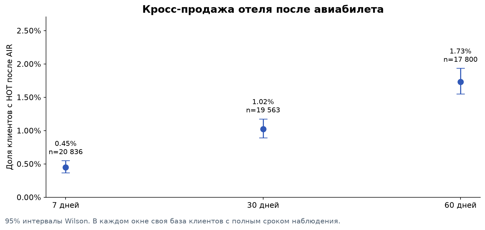

# Аналитика путешествий: авиабилеты, отели и кросс-продажи

Учебный проект по публичной выборке Т-Банка из DANO 2024–2025. Цель — оценить повторные покупки и переход от авиабилетов к отелям, затем предложить проверяемую продуктовую гипотезу.

Это переработка [проекта Дениса Морозова (Kor4yz)](https://github.com/Kor4yz/T-bank_analysis_hotels_and_air_travel). Код анализа написан заново; источник данных и исходная лицензия сохранены. Проект не является коммерческой работой в Т-Банке.

## Посмотреть результат

- [Отчёт с графиками](reports/report.html) — скачайте и откройте в браузере; интернет для просмотра не нужен.
- [Аналитическая записка](reports/analysis.md) — выводы, определения и ограничения прямо на GitHub.
- [Выполненный ноутбук](notebooks/travel_analysis.ipynb) — расчёты и визуализации.
- [План эксперимента](reports/tables/experiment_plan.csv) — чувствительность размера выборки к MDE.



## Главный результат

В фиксированной выборке **38 053 заказа** за 1 января — 6 ноября 2024 года. После первого наблюдаемого успешного AIR-заказа **200 из 19 563 клиентов (1,02%)** забронировали отель в течение 30 дней. В базу включены только клиенты без более раннего наблюдаемого HOT и с полным 30-дневным окном. Интервал Wilson 95%: **0,89–1,17%**.

Это описание поведения в выборке. Оно не доказывает, что персональная рекомендация увеличит продажи: для этого предложен A/B-тест, который в рамках проекта не проводился.

## Что изменено относительно исходника

- 2 368 строк клиентов без заказа отделены от заказов; повторяющийся технический ID таких строк не считается дубликатом заказа.
- Неизвестный статус учитывается отдельно: у 386 заказов отелей он отсутствует.
- Номинальная стоимость успешных бронирований отделена от выручки и прибыли банка.
- Первая наблюдаемая покупка не называется первым привлечением клиента.
- Для кросс-продаж контролируется срок наблюдения, для retention — полнота месяцев. Будущие периоды оставлены пустыми.
- Пропуски скидок не превращаются в нулевые скидки; причинный эффект промокодов не заявляется.
- Выводы вычисляются из данных. Неполный ноябрь и отсутствующий декабрь не используются для утверждений о сезонности.
- SQL-агрегации автоматически сверяются с pandas. Тесты проверяют дубликаты, пропуски, даты, цензурирование и границы окон.

## Воспроизведение

Python **3.12**. Команды выполнять из корня проекта.

```bash
python -m venv .venv
```

Активируйте окружение (`.venv\Scripts\activate` на Windows либо `source .venv/bin/activate` на macOS/Linux), затем:

```bash
python -m pip install -r requirements.txt
python scripts/download_data.py
python -m travel.pipeline
python -m pytest -q
```

CSV скачивается с фиксированного коммита и проверяется по SHA-256. В архив включены готовые результаты; исходный CSV скачивается отдельно и не коммитится в Git. При наличии файла можно указать свой путь:

```bash
python -m travel.pipeline --data /path/to/dataset_travel.csv --out reports
```

Если передан другой набор, отчёт пересчитывается, а `matches_reference` в `reports/manifest.json` показывает несовпадение с эталоном. Числа в этом README относятся к фиксированной исходной версии.

Для повторного выполнения ноутбука откройте `notebooks/travel_analysis.ipynb` в Jupyter или VS Code после скачивания данных. Все ячейки выполняются сверху вниз. Для воспроизведения окружения проверки см. `requirements-tested.txt`.

## Структура

```text
travel/data.py       проверка гранулярности, дат и сумм
travel/metrics.py    метрики, когорты, кросс-продажи
travel/plots.py      графики
travel/report.py     аналитическая записка и HTML-отчёт
travel/pipeline.py   CLI и сверка SQL с pandas
sql/                выполняемые SQL-агрегации
tests/              тесты граничных случаев
scripts/            загрузка данных
notebooks/          выполненный анализ
reports/            отчёт, таблицы, графики, manifest
docs/               определения полей, источники, вопросы для защиты
```

## Как интерпретировать метрики

Доля SUC — доля заказов с этим статусом в выгрузке; это не конверсия посетителя в покупку. Для неё нет полной цепочки сессий, показов и кликов. Стоимость заказа — цена бронирования, а не доход банка. Кросс-продажа означает последовательность AIR и HOT у клиента, но не гарантирует одну и ту же поездку. Низкая доля может отражать покупки вне сервиса и состав выборки.

## Источники

- [DANO 2024–2025: отели и авиабилеты](https://dano.hse.ru/data2024).
- [Официальный словарь полей](https://dano.hse.ru/mirror/pubs/share/987926897.pdf).
- [Фиксированная версия исходного проекта](https://github.com/Kor4yz/T-bank_analysis_hotels_and_air_travel/tree/d69b9db256cee03e6983d8b78e5b82d50b127401).

Подробности происхождения и лицензии — [SOURCES.md](docs/SOURCES.md). Для публикации используйте формулировку «учебный проект по публичным данным Т-Банка» и сохраняйте ссылку на исходную работу.
